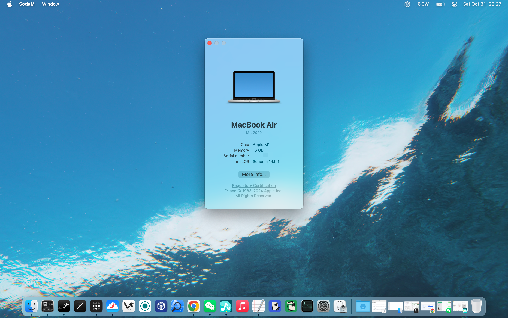

# t26 — 全透明的 macOS 菜单栏

把菜单栏的 Liquid Glass 背板整层中和掉：文字、图标、时钟、状态项、pill、苹果
logo、阴影**全部保留**，只是那块毛玻璃消失，露出桌面。

做法是在 WindowServer 内部做手术：lldb 挂断点 + 一条 Objective-C 表达式，把
`*MenuBarBackdrop*` 层的 `hidden` / `opacity` / `contents` / `filters` 一起清掉，
连它的子层（`SLMenuBarEnhancementLayer`）也一起清。**不往进程里加载任何代码**
（AMFI 的 platform-binary 限制拦不到），**不写任何磁盘状态**——注销或重启即完全恢复。



macOS 14.6.1 / MacBook Air M1，跑完 `sudo t26 settle` 之后的样子。整条菜单栏没有
背板，壁纸直接透上来；苹果 logo、`SodaM`/`Window` 菜单、右侧的状态项和时间一个
都没少——被中和掉的只是那块毛玻璃图层。

```
$ sudo t26 settle
```

```
✓ menu bar backdrop removed — 5.4 s
  hidden         18 layer(s) across 2/2 display(s), 9 repair pass(es)
  debugger       detached, 2 breakpoint(s) disabled — WindowServer runs at full speed
  untouched      text, icons, status items, pills, shadow
  undo           log out or reboot (nothing is persisted)
```

## 安装

只需要 Command Line Tools（不需要 Xcode），并且 **SIP 已关闭**（`csrutil status`
显示 disabled，在恢复模式里 `csrutil disable`）。

```sh
make                 # swiftc 直接编译出 bin/t26（纯 CLT 自带的 SwiftPM 跑不动，
                     # 所以这里没有 Package.swift，make 就是构建系统）
sudo make install    # → /usr/local/bin/t26
                     # → /usr/local/libexec/t26/{t26-engine.sh,ws_hook.py}
```

`t26` 需要 root 的子命令会自己 `exec sudo`，不用你手打 `sudo`（它也会把你
终端里的 `T26_*` 环境变量带过去）。想自己管理就用 `sudo t26 ...`。

## 用法

```sh
t26 settle            推荐：修好就放开断点，之后 WindowServer 零开销、不卡
t26 status            现在这台机器什么样（SIP、显示器、上次运行结果）
t26 doctor            体检：缺什么、怎么补，退出码 3 表示硬性条件不满足
t26 logs [-n N] [-f]  看 hook 日志；-f 边跑边看
t26 abort             兜底：把 WindowServer 要回来（往控制管道写 detach）

sudo t26 fix -s 600   调试用：一直挂断点，每次重建补一刀（会掉帧）
sudo t26 tree         只 dump 活的菜单栏 CALayer 树，什么都不改
sudo t26 probe        只读：打印 WindowServer 给层起的名字
sudo t26 hunt         只读：打印菜单栏代码调用的 render setter
sudo t26 theme        只读：打印 CoreUI 材质渲染器画了什么
```

常用选项：

```
-s, --seconds N     时间预算（settle 40 · fix 900 · tree/probe/theme 25 · hunt 60）
-p, --pattern S     要中和的层名子串（默认 MenuBarBackdrop）
    --shallow       只隐藏，不清 opacity/contents/filters
    --settle-min N  最早 detach 的时间，秒（默认 4）
    --settle-max N  最多等显示器确认多久，秒（默认 60）
    --strict        不是每块屏都确认就退出 3（适合脚本）
    --json          settle/fix/status/doctor 输出机器可读结果
    --pid N         对别的进程动手（测试用，不需要 sudo）
    --log PATH      hook 日志路径（默认 /tmp/t26hook.log）
```

退出码就是契约：`0` 修好了 · `1` 没修好 · `2` 用法错 · `3` 被挡住
（SIP / 权限 / `--strict`） · `4` WindowServer 不在 · `5` 引擎失败 · `130` 中断。

### `settle` 在等什么

挂断点的这几秒会卡一下（每次命中断点，WindowServer 的所有线程都被停住，这就是
卡顿的唯一来源）。`settle` 会：

1. 每次 pill resize（每次重建 3 次）都把整棵 bar 的 backdrop 清一遍；
2. 等**每一块**显示器报告的 bar 根层都至少被修过 2 次（`2/2 display(s) confirmed`）；
3. 禁用断点、detach —— 从这以后 WindowServer 身上没有调试器，跑满速。

只修一次就撒手不行：WindowServer 重建时会重置 `hidden`，而且每块屏各自重建，
先修好的那块可能在你 detach 之后又被画回毛玻璃。所以「每块屏都确认」是硬条件；
到 `--settle-max` 还没凑齐就警告并结束（那块屏可能还是毛玻璃，加时间重跑）。

### 不要 Ctrl-C

挂上 lldb 时 WindowServer 被 ptrace 停住，**SIGINT 会让 batch lldb 直接 kill 目标**，
而目标是 WindowServer —— 桌面就没了。

`t26` 为此做了两道保险：引擎跑在自己的进程组里（终端的 Ctrl-C 传不到 lldb），
CLI 自己也忽略 SIGINT。真卡住了，另开一个终端：

```sh
sudo t26 abort
```

### 撤销

注销或重启。磁盘上只会多出 `/tmp/t26hook.log`、`/tmp/t26-ctl` 之类的临时文件。

## 目录

```
Sources/t26/            CLI（swiftc，无 Xcode 依赖）
  main.swift            入口：分发子命令
  CLI.swift             参数解析、帮助文本
  Commands.swift        settle/fix/tree/... 的报告渲染 + status/doctor/logs/abort
  Engine.swift          起引擎、流式转发日志、解析结果
  Log.swift             日志 → RunSummary（层数 / 显示器确认数 / 结论）
  Layout.swift          找 libexec（T26_LIBEXEC / exe 相对 / /usr/local）
  System.swift          sudo 提权、子进程、SIP/显示器/用户名探测
  Style.swift           颜色、两栏报告、退出码
libexec/t26/
  t26-engine.sh         lldb 控制器：attach / 断点 / 等 done / detach
  ws_hook.py            lldb Python 回调：单表达式修复、层树遍历、settle 判定
tools/
  ws-symbols.sh         运行时符号探查（只读）
  ws-disasm.sh          update_menu_bar_layers 等函数的符号化反汇编
docs/                   逆向笔记（机制 / 地址与坑 / 死路 / 性能）
```

## 文档

| 文件 | 内容 |
| --- | --- |
| [docs/01-how-it-works.md](docs/01-how-it-works.md) | 机制：层树结构、入口 `resize_one_pill`、为什么要「深度」中和、settle 判定 |
| [docs/02-reverse-engineering.md](docs/02-reverse-engineering.md) | 逆向笔记：SkyLight 地址、Mach-O 布局、lldb 批量脚本与表达式 JIT 的坑 |
| [docs/03-dead-ends.md](docs/03-dead-ends.md) | 死路：alpha override、dylib 注入、setName 漏斗、CoreUI renderer |
| [docs/04-performance.md](docs/04-performance.md) | 为什么卡（ptrace 停进程）、实测数据、`settle` 为什么能撒手 |

## 已验证

- 本机 macOS 14.6.1（Darwin 23.6，Apple Silicon）：单屏、双屏都实测通过——
  玻璃消失、文字图标完整、切窗口不卡，detach 之后两块屏都保持透明。
- 目标观感是 macOS 26 那种「没有毛玻璃、直接透出桌面」的状态栏。
- 换 macOS 版本时唯一可能变的是层名：先用 `sudo t26 tree` 看真实层树，
  必要时 `--pattern` 换子串；`t26 doctor` 会先把前置条件过一遍。

## 环境

macOS + Apple Silicon；Command Line Tools 即可，不需要 Xcode；SIP 必须关闭。
