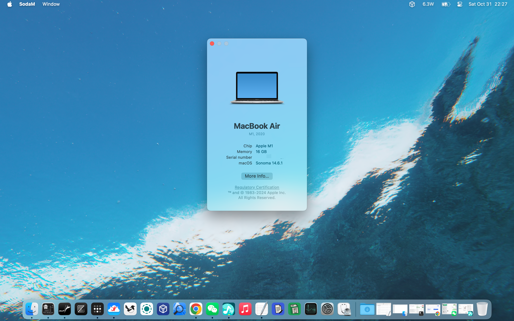

# t26 — a macOS 26-style transparent status bar (C / mach_vm)

Removes the menu bar's backdrop layer, so the bar becomes fully transparent: text,
icons, clock, status items, pills, the Apple logo and the shadow are **all kept**,
only the frosted panel behind them disappears and the desktop shows through.

`t26` means macOS 26: the goal is the fully transparent status bar of macOS 26,
brought to earlier releases by removing the menu bar backdrop.

It replaces the earlier `lldb`/agent design with a single C program. No debugger,
no daemon and no kernel extension:

```sh
sudo t26
```

It reads WindowServer's memory with `task_for_pid` + `mach_vm_read_overwrite`,
finds the committed `CA::Render::Layer` for the backdrop, and writes two fields
with `mach_vm_write`. WindowServer is never stopped, so there is no lldb-style
freeze or stutter.



macOS 14.6.1 on a MacBook Air M1, right after the command. The whole bar has no
backdrop and the wallpaper comes straight through, while the Apple logo, the
menus, the status items on the right and the clock are untouched — the only
thing removed is the glass layer.

```
$ sudo t26
found 2 backdrop render layer(s) in 2.3s
  enabled 0x106c4e240
  enabled 0x1071191e0
ok: 2/2 layer(s) transparent
```

## How it works

`t26` does not run code inside WindowServer and does not need a commit. The
compositor reads the **committed render tree** every frame; editing that snapshot
is enough:

```
CA::Render::Layer + 0x60  = 0          # contents (the material image)
CA::Render::Layer + 0x24 |= 1 << 34    # backdrop-only hidden flag
```

`contents = 0` alone leaves a grey background. Bit 34 is the backdrop's own
hidden flag; bit 32 is a different flag that hides the **whole** menu bar
(including its text), so this tool never uses it.

The original contents pointer is overwritten without an unref; the image object
is leaked for the rest of the WindowServer session. There is no state file and no
`disable`: log out / restart WindowServer to undo.

Details, offsets and the scan predicate: [docs/01-how-it-works.md](docs/01-how-it-works.md).  
How to re-derive the offsets on another macOS: [docs/02-reverse-engineering.md](docs/02-reverse-engineering.md).

## Install

Command Line Tools are enough (no Xcode), and **SIP has to be disabled**
(`csrutil status` must say disabled: boot into Recovery and run `csrutil disable`).

```sh
make                 # clang -O2, no dependencies
sudo make install    # → /usr/local/bin/t26
```

The installed binary is ad-hoc signed; it is a userspace executable, not a kext,
so it does not need kext approval.

## Usage

```sh
sudo t26             # make the menu bar transparent; keep text/icons
```

Run it again after WindowServer rebuilds the menu bar (app switch, wallpaper
change, display change): a rebuild may replace the render layer. The scan costs
about 2–5 seconds of CPU in the `t26` process, but it does not stop WindowServer
and does not freeze the desktop.

Undo: log out, or restart WindowServer. There is no `disable` command and
nothing is persisted on disk.

Requirements:

- Apple Silicon, macOS 14.x (measured on 14.6.1 / 23G93, M1);
- root for `task_for_pid`;
- SIP disabled.

Different macOS releases move the QuartzCore fields. The source keeps the
measured values in a small `#define` block; the reverse-engineering notes explain
how to re-derive them. If `t26` reports `0 backdrop render layer(s)`, the name
string or the render-layer layout changed — see docs/02.

## Layout

```
t26.c                    scan + write implementation (C only)
Makefile                 build / install
docs/01-how-it-works.md  implementation and the two fields
docs/02-reverse-engineering.md
                         how to find the layer, flags and offsets on a new macOS
docs/example.png         screenshot of the target effect
```
